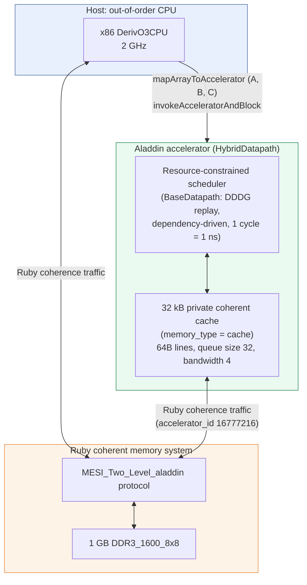

# System architecture

Referenced by `docs/REPORT_SKELETON.md` §2. Parameters here are pulled
directly from `benchmarks/*/gem5*.cfg` and `docs/BUILD.md`'s "What is
measured" — cross-check against those files if this drifts.

## What differs between kernel variants

The **only** changed variable across `benchmarks/gemm_acp_pilot/` (1
column), `benchmarks/gemm_tiled2/` (2 columns), and `benchmarks/gemm_tiled4/`
(4 columns) is how many output columns share each loaded A element inside
the accelerator's inner loop (`gemm_kernel()`'s `loop_j` step size and
accumulator count). CPU model, Ruby coherence protocol, cache size/config,
clock, DRAM, and host invocation protocol (`mapArrayToAccelerator` /
`invokeAcceleratorAndBlock`) are held identical across every variant and
every N — see the `.cfg` files, which are copied verbatim between variants
specifically to hold this fixed.

## What "repeated invocation" means in this diagram

For the Gate 1 dynamic-input tests (`scripts/run_repeated.sh`), the CPU
calls `invokeAcceleratorAndBlock()` more than once in a loop, mutating array
`A` between calls. The accelerator's *private cache* (top box above) is not
reset between these calls — so a second call can find data already resident
from the first call's accesses. This is the physical basis for the
"cold vs. warm invocation" distinction throughout `docs/RESULTS.md`: it is
a real property of this coherent-cache design, not a simulation artifact.
