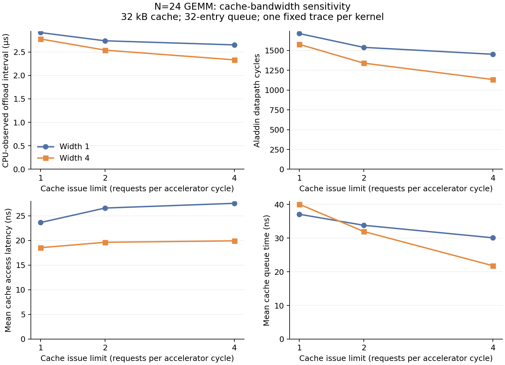

# Cache-bandwidth sensitivity study

This extension asks whether the benefit of output-column tiling depends on
the coherent accelerator's cache-request issue limit. It uses integer GEMM
at N=24, tile widths 1 and 4, and `cache_bandwidth` settings 1, 2, and 4.
All six points are newly run in a single cohort. Published bandwidth-4
results are not used as the denominator for the new comparisons.

## Completed result

The [2026-09-30 cohort](../results/cache_bandwidth/n24_20260930/SUMMARY.md)
passed all six full accelerator checks and both CPU checks. Its raw logs,
effective configurations, traces, model outputs, CSV, and standalone figures
are retained under that cohort directory.

| Issue limit (requests/cycle) | Width-1 cycles | Width-4 cycles | Cycle reduction | Width-1 offload (µs) | Width-4 offload (µs) | Offload reduction |
| ---: | ---: | ---: | ---: | ---: | ---: | ---: |
| 1 | 1,714 | 1,578 | 7.935% | 2.913 | 2.777 | 4.669% |
| 2 | 1,539 | 1,340 | 12.930% | 2.738 | 2.539 | 7.268% |
| 4 | 1,452 | 1,133 | 21.970% | 2.651 | 2.332 | 12.033% |



The tiling benefit increases as the issue limit increases. Both kernels
slow down with a tighter limit, but width 4 is more sensitive: moving from
4 to 1 request/cycle increases its datapath cycles by 39.28%, versus 18.04%
for width 1. This is consistent with wider tiles needing enough issue
capacity to exploit their exposed concurrency. It supports sensitivity to
the cache interface, not a unique identification of the bottleneck or a
claim that fewer source loads necessarily give a larger benefit under
tighter bandwidth.

For these six measurements only, the reset-to-completion interval exceeds
Aladdin's reported datapath duration by exactly 728 ns, and the subsequent
host-return interval is exactly 471 ns. Thus observed offload time equals
datapath cycles times 1 ns plus 1.199 µs. These are measured residuals in
this harness, not separately isolated command or coherence costs, and should
not be generalized to other sizes or invocation setups. They explain why
the offload percentage gains are smaller than the cycle percentage gains.

Counter changes are mixed. Mean queue time falls as issue bandwidth rises,
but mean cache access latency rises in each kernel. At bandwidth 1 the
reported load/store counts are 74/610 (width 1) and 74/602 (width 4);
at bandwidth 2 they are 72/576 and 72/577; at bandwidth 4 both are 72/576.
The full histogram sample counts are retained in CSV. These counters
describe returned cache operations in the pinned implementation, not
source loads or raw byte traffic; their variation is compatible with
timing-dependent request merging and does not establish that explanation.

Bandwidth-4 cycle counts reproduce the existing single-call results.
Absolute offload ticks differ from historical cohorts, so all percentages
above use this cohort's own baseline. Accelerator-host instruction counts
are equal across the six ROI runs (21,635), but differ from the historical
harness cohort (21,600). Generated paths and executable locations differ;
cross-cohort equality is not asserted.

## Reproduce

After the ordinary simulator setup, run from the repository root:

```bash
bash scripts/run_cache_bandwidth.sh
```

The command creates a timestamped directory in `results/cache_bandwidth/`.
An optional first argument sets its name. Existing result directories are
never overwritten. The source checkout is mounted read-only; compilation,
trace generation, and Aladdin temporary outputs use an isolated directory
under `.artifacts/cache_bandwidth/`.

The default container engine is Docker and the default source volume is
`coherent-gemm-source`, as in the main study. To use another already-built
source checkout or a Docker-compatible Podman wrapper, set:

```bash
COHERENT_GEMM_SOURCE=/absolute/path/to/gem5-aladdin \
COHERENT_GEMM_CONTAINER_ENGINE=/absolute/path/to/container-wrapper \
bash scripts/run_cache_bandwidth.sh my_bandwidth_cohort
```

The container engine variable names an executable, not a shell command.
The checked-in runner uses the same pinned image and verifies the finite
queue patch before simulation. Each simulation has a 900-second timeout;
a timeout or failed check stops the cohort and prevents summary acceptance.

Recompute the completed reference without running the simulator:

```bash
python3 scripts/summarize_cache_bandwidth.py results/cache_bandwidth/n24_20260930
python3 -m unittest discover -s tests -p 'test_cache_bandwidth.py'
(cd results/cache_bandwidth/n24_20260930 && sha256sum -c SHA256SUMS)
```

Optional standalone figures require Matplotlib:

```bash
python3 -m pip install matplotlib
python3 scripts/plot_cache_bandwidth.py results/cache_bandwidth/n24_20260930
```

PNG, PDF, and SVG figures are generated from freshly validated raw evidence.
The reference device uses a local Python virtual environment for plotting;
that environment is not required to inspect logs or regenerate the CSV.

## Controls and measurements

- Queue capacity: 32 entries; coherent cache: 32 kB, four-way, 64-byte lines.
- CPU: the existing x86 `DerivO3CPU`; CPU clock 2 GHz, accelerator/system/Ruby
  clocks 1 GHz. The runner preserves the existing command-line defaults;
  the effective CPU clock is 500 gem5 ticks, rather than the 1 GHz assumed
  in some earlier prose.
- Each kernel generates one trace, shared by all its bandwidth settings
  and measurement stages. Both compressed and logical trace hashes and
  the compressed trace itself are saved.
- Each point runs `full`, `roi`, and `invocation` in separate fresh gem5
  processes. Full checks compare every output element against the CPU
  reference. A standalone full-check CPU execution is also saved for each
  kernel. Timing stages use the existing lightweight checksum.
- Offload time sums the pre-invocation-reset-to-accelerator-completion
  block and the subsequently reset completion-to-host-return block.
  The validator checks their descriptions and final-tick arithmetic.
- Datapath cycles come from Aladdin's `Cycle` line; cache loads/stores,
  latency histogram samples/means, and queue-time samples/means come
  from the full stage. Whole-program ticks come from the ROI stage.

The validator requires all six points and all 18 accelerator stages,
positive schedules, full correctness records, matching checksums, equal
accelerator-host instruction counts, shared trace hashes, and identical
stage-specific binary hashes across bandwidths. It checks all effective
gem5 configuration entries within each stage, normalizing only kernel
names and generated paths, and permits `cacheBandwidth` to vary.

## Interpretation limits

`cache_bandwidth` is a request issue limit inside Aladdin's cache interface,
not a DRAM bandwidth setting. The pinned source's
`HybridDatapath::handleCacheMemoryOp()` checks `cache_queue.canIssue()` and
increments its issue count when a request is accepted. Translation,
request merging, queue occupancy, cache service, and dependency scheduling
can all interact with that gate. A changed width benefit demonstrates
sensitivity to this parameter; it does not alone prove that request
throughput is the unique bottleneck.

Source-level input loads, optimized datapath operations, and issued cache
requests are distinct quantities. In particular, the source-level
`2N^3` baseline count must not be treated as the observed cache request count.

The same CACTI characterization files remain fixed. Model area is retained
for diagnostics, but it does not estimate the physical implementation cost
of the different issue limits. This sweep supports latency and counter
comparisons, not claims of physical cache-port area or energy savings.

Single-invocation cache state and fixed deterministic inputs are retained.
This study makes no claim about arbitrary runtime input mutation or warm
repeated-call behavior.
