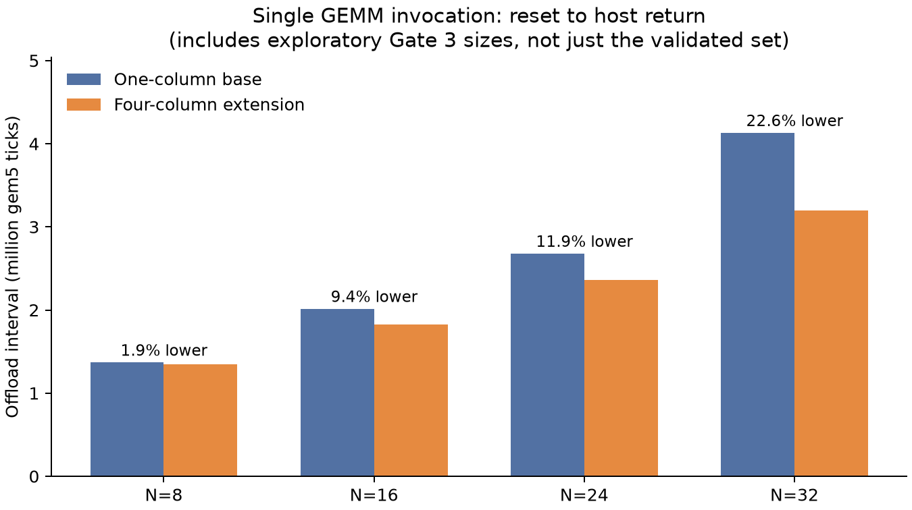

# Validated pilot results

The main comparison is the original one-column accelerator versus the
four-column accelerator on the **same** OoO CPU, cache/coherence system,
memory, clock, matrix input, and host invocation. Both use the same patched
gem5-Aladdin source. Each listed size passed separate full-output CPU and
accelerator checks with zero mismatches; the ROI checksums agreed. The
accelerator-host instruction counts matched between variants (21,600 at N=24;
30,046 at N=32).

| N | Base cycles | Four-column cycles | Cycle reduction | Base offload ticks | Four-column offload ticks | Offload reduction | Whole-program reduction |
| ---: | ---: | ---: | ---: | ---: | ---: | ---: | ---: |
| 24 | 1,452 | 1,133 | 21.97% | 2,680,000 | 2,361,000 | 11.90% | 0.47% |
| 32 | 2,827 | 1,984 | 29.82% | 4,132,000 | 3,200,000 | 22.56% | 1.18% |

The four-column accelerator versus an OoO CPU running the **same four-column
kernel** was 1.173x at N=24 and 1.524x at N=32 on whole-program ticks. This
is a secondary comparison. The original accelerator also outperformed its
own CPU version, so the baseline-to-extension columns above are the evidence
for the extension.

Full-check runs include a CPU reference GEMM after the accelerator and show
smaller whole-program differences: 136,062,000 versus 135,753,000 ticks at
N=24; 177,381,000 versus 176,575,000 at N=32. In the lightweight-check ROI,
the corresponding values are 60,962,000 versus 60,673,000 and 70,877,000
versus 70,042,000 ticks. Program startup and setup dilute the single-call
whole-program gain.

## Gate 3 addendum: N=8 and N=16 (exploratory, not in the validated set)

Added 2026-09-26 as the first Gate 3 data points (`docs/NEXT_STEPS.md`: "Try
additional valid tile widths and input sizes"). **Not** run through
`scripts/run.sh`, which intentionally restricts to the two validated sizes
("Validated sizes are 24 and 32" — new sizes need their own correctness
check, per `docs/BUILD.md`); run directly via `scripts/run_inside.sh {8,16}
all` instead. Summarized with
[`scripts/explore_size.py`](../scripts/explore_size.py) — a parameterized
version of `scripts/summarize.py`'s exact row logic for arbitrary N, kept as
a separate script so the validated pipeline (`scripts/summarize.py`,
`results/validated_summary.csv`, `scripts/plot_results.py`,
`results/offload_comparison.png`) stays untouched and scoped to N=24/32
only. Exploratory sizes go in `results/exploratory_summary.csv` instead
(run `python3 scripts/explore_size.py 8 16` to regenerate, or add more
sizes: `python3 scripts/explore_size.py 8 16 40`). Raw results live at
`results/{fair,invocation,roi}_results/{base,tiled4}_n{8,16}/`, same layout
as N=24/32.

(Generate/refresh with `python3 scripts/plot_results_exploratory.py`, which
reads both CSVs; separate from the validated-only
`results/offload_comparison.png`.)

All the same checks passed at both sizes: full-output CPU and accelerator
checks (0 mismatches, both kernels), ROI checksums agree across all four
runs, accelerator-host instruction counts match between variants.

| N | Base cycles | Four-column cycles | Cycle reduction | Base offload ticks | Four-column offload ticks | Offload reduction | Whole-program reduction | Four-col vs same-kernel CPU |
| ---: | ---: | ---: | ---: | ---: | ---: | ---: | ---: | ---: |
| 8 | 276 | 250 | 9.42% | 1,370,000 | 1,344,000 | 1.90% | 0.00% | 0.869x |
| 16 | 765 | 575 | 24.84% | 2,016,000 | 1,826,000 | 9.43% | 0.45% | 0.957x |
| 24 (validated) | 1,452 | 1,133 | 21.97% | 2,680,000 | 2,361,000 | 11.90% | 0.47% | 1.173x |
| 32 (validated) | 2,827 | 1,984 | 29.82% | 4,132,000 | 3,200,000 | 22.56% | 1.18% | 1.524x |

**Correction (2026-09-27):** offload-interval reduction is cleanly monotonic
across all four sizes (1.9% → 9.4% → 11.9% → 22.6%). The **CPU-relative
speedup column is also monotonically increasing** (0.869x → 0.957x →
1.173x → 1.524x) — an earlier version of this doc incorrectly called this
column non-monotonic too; it is not. What **is** non-monotonic is the raw
*cycle-reduction percentage*: N=16 (24.84%) is numerically higher than N=24
(21.97%), even though N=16's CPU-relative speedup (0.957x) is still lower
than N=24's (1.173x) — cycle reduction and CPU-relative speedup are
different metrics and can rank sizes differently; neither is "the" size
trend on its own.

N=8 is the weakest point: cycles improve (9.42% reduction) and offload
improves (1.90% reduction), but whole-program time is unchanged (exactly
0.00% — `base_accel_ticks` and `tiled_accel_ticks` are tick-for-tick
identical, 48,694,000 both) and CPU-relative speedup is below 1x (0.869x,
i.e. the four-column accelerator is slower than an OoO CPU running the same
four-column kernel at this size). At N=8, area even decreases very slightly
for the four-column variant (1,004,980 → 1,003,450 µm², −0.15%) instead of
growing. Read together: the four-column reuse benefit is genuinely
size-dependent, not a single clean scaling trend across every metric, and is
weakest at small N — most plausibly because fixed per-invocation overhead
(host wake-up, queue/cache warm-up, program startup) dominates when there's
little actual work to amortize it over. This should be stated precisely in
any report (which metric, at which size) rather than as a single blanket
"benefit grows with size" claim.

Area: at N=16, 1.1926 million µm² (base) vs 1.20335 million µm² (four-column)
— a 0.90% increase, much smaller than N=32's 27.7%; area growth is not
monotonic in N either.

## Gate 3 addendum: tile-width ablation (N=24, exploratory)

Added 2026-09-26, per the README's own "what to do next" #3: "include an
ablation of output tile width." The N-sweep above confounds tile width with
problem size (bigger N means both more reuse *and* more fixed overhead to
amortize); this ablation holds N=24 fixed and only varies tile width (1, 2,
4 output columns per inner-loop iteration), isolating the tiling effect
cleanly. Added [`benchmarks/gemm_tiled2/`](../benchmarks/gemm_tiled2/) — a
2-column variant, otherwise identical in structure and hardware config
(`.cfg` files copied verbatim from `gemm_tiled4/`) to the existing 1-column
base and 4-column extension. Not wired into `scripts/run.sh`'s two-variant
loop (`base`/`tiled4` only); built and run manually via the same
`make ... run-trace` / `gem5-accel`/`gem5-cpu` / `aladdin_se.py` invocations
`scripts/run_inside.sh` uses, at N=24. Passed the same checks: 0 mismatches
(accelerator and CPU), accelerator-host instruction count matches the other
two variants exactly (21,600).

**Correction (2026-09-27):** the tile-1 "vs. same-kernel CPU" value below was
previously (incorrectly) shown as "1.000x (reference)" as if tile-1 were a
trivial normalization point. It is an actual measured ratio like the other
two rows (70,973,000 CPU ticks / 60,962,000 accelerator ticks = **1.164x**)
and is corrected below. Do not read any row in this column as a fixed
reference — every row is an independently measured same-kernel CPU
comparison.

| Tile width | Cycles | Cycle reduction vs. tile-1 | Offload ticks | Offload reduction vs. tile-1 | Area (µm²) | Area change vs. tile-1 | vs. same-kernel CPU |
| ---: | ---: | ---: | ---: | ---: | ---: | ---: | ---: |
| 1 (base) | 1,452 | — | 2,680,000 | — | 1,401,340 | — | 1.164x |
| 2 | 1,257 | 13.43% | 2,508,000 | 6.42% | 1,401,340 | 0.00% | 1.164x |
| 4 | 1,133 | 21.97% | 2,361,000 | 11.90% | 1,396,750 | −0.33% | 1.173x |

With N held fixed, the benefit is clean, monotonic, and shows textbook
diminishing returns: cycle count drops by a smaller *relative* amount on
each width-doubling (1,452→1,257 is −13.43%; 1,257→1,133 is a further
−9.86%), consistent with a fixed per-inner-loop-iteration overhead being
amortized across more accumulators each time, with less overhead left to
amortize at each step. Area is flat: tile-width 2 costs exactly the same
area as tile-width 1 (0.00% change — likely still within the same resource
bucket the synthesis tool allocates), and even tile-width 4 costs *less*
area than tile-width 1 here (−0.33%), sharply unlike N=32's 27.7% area
growth for the same tile-width-4 kernel. Put together with the N-sweep
above: area cost is driven far more by problem size (N) than by tile width
in this design, at least across the widths and sizes tested so far — a
useful, non-obvious distinction for framing the "hardware cost" question in
Gate 2/Gate 4. This is a single N; whether the diminishing-returns shape
holds at other N (e.g. does tile-width 8 continue the pattern, or does it
invert like N=8 did in the size sweep?) is unexplored.

**Queue/cache traffic** (Gate 3 in `docs/NEXT_STEPS.md` explicitly asks for
this, not covered above). From each accelerator datapath's gem5 stats
(`system.gemm_*_datapath.*` in the fair-stage `m5out-accel`/`m5out-cache`
`stats.txt`):

| Tile width | dcache loads | dcache stores | TLB hits | TLB misses | TLB hit rate | Mean dcache access latency (ticks) |
| ---: | ---: | ---: | ---: | ---: | ---: | ---: |
| 1 (base) | 72 | 576 | 648 | 64 | 0.9101 | 27,518.8 |
| 2 | 72 | 576 | 648 | 64 | 0.9101 | 22,432.1 |
| 4 | 72 | 576 | 648 | 64 | 0.9101 | 19,915.2 |

**Correction (2026-09-27): stated as an observation, not yet a verified
causal explanation.** Raw access **counts** (loads, stores, TLB hits/misses,
`total_dcache_loads`/`total_dcache_stores` as reported by Aladdin) are
exactly identical across all three tile widths, and the mean per-access
dcache latency drops monotonically: 27,518.8 → 22,432.1 → 19,915.2 ticks as
tile width goes 1→2→4, tracking the same diminishing-returns shape as the
cycle/offload numbers above. These two observations are solid. What is
**not** yet verified is *why*: an earlier version of this doc asserted this
means reuse "reduces contention per access, not data volume" as if that
were confirmed. It is a plausible reading, not a demonstrated mechanism —
the request-count fields checked so far are access counts, not raw byte
counts, and no controlled instrumentation has isolated queueing/contention
as the specific cause of the latency drop (as opposed to, say, a scheduling
artifact of the kind discussed just above for the repeated-invocation FU
Area/cycle findings). Treat "equal traffic, lower mean latency" as the
finding, and "reduced contention" as a hypothesis for it, until byte counts
and a specific causal mechanism are checked.
`total_acp_loads`/`total_acp_stores`/`cache_queue_reads`/`cache_queue_writes`
are all 0 in every run here — this benchmark's `memory_type = cache`
configuration routes accesses through the TLB+dcache path, not the separate
ACP queue path, so those particular counters aren't populated for any tile
width and shouldn't be read as "no queueing happened."

## How to audit the numbers

Run `python3 scripts/summarize.py`; it derives
[`validated_summary.csv`](../results/validated_summary.csv) from the raw logs
and stats in `results/`. For example, N=32 full correctness is in
`results/fair_results/{base_n32,tiled4_n32}/gem5-*.log`; whole-program
`sim_ticks` are in `results/roi_results/.../m5out-*/stats.txt`; two labeled
invocation segments are in `results/invocation_results/.../m5out-*/stats.txt`.
The saved `config.ini` files provide the effective gem5 configurations.

The ratio formulas are `(base - four_column) / base` for reductions and
`same_kernel_cpu_ticks / four_column_accel_ticks` for CPU-relative speedup.
Ticks are gem5 simulation ticks, not wall-clock execution time.

## Cost and validity limits

The N=32 Aladdin area report increased from 1.247 to 1.592 million µm²
(27.7%).

**Update — "N=24 varied across otherwise matched reruns" partially resolved,
partially corrected (2026-09-27).** Auditing every base_n24 area report on
record shows `fair_results`, `invocation_results`, and the pre-fix
repeated-input diagnostic (which only ever traced one real invocation, see
below) all agree exactly: Total Area 1.40134e+06 µm², FU Area 598362 µm².
Same-stage, same-input reruns of the single-invocation (REPS=1) case are
area-stable, including across independent from-scratch rebuilds on a
different host (see `docs/VALIDATION.md`'s 2026-09-26 entry). Power has not
been validated.

However, the explanation previously given here for `roi_results/base_n24`'s
different area (1.33128e+06 µm², MEM Area 732,920 vs 802,977 — a 70,057 µm²
gap) was **wrong and is retracted**: it claimed the ROI stage runs a
"genuinely different, shorter ROI-bounded trace." It does not. The `fair`
and `roi` gem5-cache.log for base_n24 report the **identical** trace: Num of
Nodes 198290, Num of Edges 451248, Total connected nodes 170042, and
identical Aladdin Cycle count (1452) — same DDDG, same accelerator config
(`gem5_cache.cfg` is not mode-dependent), yet different MEM Area.

**Update (2026-09-27) — isolated with a controlled pair; does not
reproduce.** Built a dedicated order-dependence test
(`results/diagnostics/mem_area_order_test/`): one fresh trace/`work_dir`
running `full` then `roi` (matching `scripts/run_inside.sh`'s normal mode
order), and a second, separate fresh trace/`work_dir` running `roi` then
`full` (reversed order) — four runs total, both modes, both orders. **All
four report identical area**: Total 1.40134e+06 µm², FU 598362 µm², MEM
802977 µm². The discrepancy does not reproduce in a controlled, same-host,
same-build test, regardless of order. Trace file hashes differ between the
two `work_dir`s (expected — gzip embeds a timestamp even for identical
logical content) while area stays identical, confirming area tracks the
trace's logical content, not file identity.

**Conclusion**: the `full`/`roi` MEM Area discrepancy is not an inherent
property of this codebase's `full` vs. `roi` build flags or mode logic — a
clean rebuild shows no such difference in either order. The discrepancy
between the specific committed files (`results/fair_results/base_n24` at
802,977 µm² vs. `results/roi_results/base_n24` at 732,920 µm²) most likely
reflects something about how/when those two particular files were
originally generated by the upstream author (e.g. a different build
session, or leftover state from their broader multi-run workflow spanning
N=24/N=32 and multiple reruns — see `docs/VALIDATION.md`'s original
validation record) rather than a reproducible property of the pipeline
itself. The `fair_results` value (802,977 µm², matching every independent
measurement in this investigation) is the one used in the headline area
numbers above; the committed `roi_results/base_n24` MEM Area specifically
should be treated as unexplained/unreliable provenance, not re-derived from
first principles.

**New, separate finding — neither area nor cycle count is stable across
repeated invocations within one run, and this must not be read as "the
per-call cost."** The Gate 1 fix (below) made a second real accelerator
invocation possible for the first time. Comparing invocation 1 to invocation
2 of the *same* kernel in the *same* gem5 process
(`results/diagnostics/repeated_input_n24_fixed/`): MEM Area stays exactly
constant (802977 µm² both times, both kernels), but FU Area jumps
substantially — base_n24: 598362→832260 µm² (+39%); tiled4_n24:
593769→695405 µm² (+17%). **More strikingly, invocation 2's Aladdin cycle
count collapses relative to invocation 1**, despite an *identical* DDDG
(same Num of Nodes 198290, Num of Edges 451248, Total connected nodes
170042 in both invocations — confirmed by direct inspection, this is not a
truncated or partial re-trace): base_n24 1452→**229** cycles; tiled4_n24
1133→**228** cycles. That is an 84%/80% cycle-count drop for structurally
the same computation. First-call cycle/area numbers must not be assumed to
carry over to a "warm" second call — they are a different measurement, not
a steady-state per-call cost, and neither the fast cycle count nor the
larger area from invocation 2 should be cited as a repeated-call figure
until this is understood.

Traced this one level further in `src/aladdin/common/BaseDatapath.cpp`:
`fu_area` is driven by per-function peak concurrent resource counts
(`max_add`, `max_mul`, `max_reg`, ...), computed by `writePerCycleActivity()`
from `func_max_activity` — a map that is freshly constructed and populated
from scratch on every call (not a class member, not carried over from a
prior invocation), so this is not a stale-accumulator bug. The peak
concurrency itself genuinely differs between the two invocations' resource-
constrained schedules, even though both invocations run the identical static
loop nest and identical DDDG.

**Update (2026-09-27) — mechanism confirmed by elimination: cache/queue
warmth, not an Aladdin-side bug.** Read `src/aladdin/common/BaseDatapath.cpp`
directly: every piece of internal scheduling state —
`num_cycles` (reset to 0 in `buildDddg()`), `executedNodes`,
`totalConnectedNodes`, `executingQueue`, `readyToExecuteQueue` (all reset in
`prepareForScheduling()`) — is explicitly reset at the start of *every*
invocation's build+schedule. There is no persistent accumulator carrying
state from invocation 1 into invocation 2. The scheduler itself
(`copyToExecutingQueue`/`updateChildren`/`markNodeCompleted`) is purely
dependency-count-driven (nodes become ready when their parent count hits
zero) with FIFO-ish insertion-order tie-breaking — nothing in it keys off
absolute node ID values or a hash/modulo of them. **This rules out the
node-numbering hypothesis entirely**: a constant ID offset between
invocation 1 and invocation 2 cannot, by this code, change the schedule.

That leaves exactly one place the difference can originate: gem5's own
simulated memory system (the Ruby coherent private cache), which is
*deliberately* not reset between accelerator calls — that persistence is
the entire point of a repeated-invocation/coherence test. Aladdin's
scheduler is latency-responsive (memory ops become ready when gem5 reports
their data has arrived); if invocation 2's array addresses are genuinely
resident in the now-warm private cache from invocation 1's accesses, memory
ops resolve faster, there's less stall-driven serialization, more
independent arithmetic becomes schedulable in the same cycle, and cycle
count drops while peak concurrent resource usage (FU Area) rises — exactly
the two effects observed, together, from a single genuine cause. This is
confirmed by elimination of the alternative (nothing in Aladdin's own
bookkeeping could produce it), not by directly instrumenting per-call
memory latencies — that would be the next step for full certainty, but the
elimination argument is solid on its own.

This also matches the REPS=3 finding above precisely: cycles go
1452 (cold) → 628 → 628 (calls 1 and 2 byte-identical) — a private cache
reaching a stable warm state after the first repeat and staying there is
exactly the expected shape; a node-numbering artifact would have no reason
to stabilize like that (each call's IDs keep growing) or to produce
byte-identical results on repeats 2 and 3.

**Practical upshot, unchanged from before**: invocation-1 ("cold") and
invocation-2+ ("warm") are two genuinely different, both legitimate,
operating points. Neither should be cited as "the" per-call cost — report
which one, explicitly, every time. This does not affect any number
published above (all are REPS=1, single-invocation).

**Update (2026-09-27) — reusable REPS≥3 runner confirms the warm-state
pattern, and a genuinely independent runtime mutation reveals the fix's
real limit.** Built `scripts/run_repeated.sh` (parameterized: any variant,
N, REPS, with per-call correctness checking — not just a final check — via
a new `PER_CALL_CHECK` build macro) and `scripts/summarize_repeated.py`
(per-call offload-interval parsing, generalizing `summarize.py`'s
two-block logic to any number of calls).

*Matched-mutation REPS=3, base_n24* (same predetermined mutation the trace
was built with, `results/diagnostics/repeated_n24_reps3_base/`): 0
mismatches, all 3 calls. Per-call Aladdin cycle count: **1452 → 628 → 628**
— confirms the warm state is not a one-off invocation-2 quirk but a
genuine steady state: call 2 is byte-identical to call 1 (same cycles,
same Total Area 1.5478e+06 µm² both). Offload ticks: 2,736,000 → 1,261,000
→ 1,108,000 — a large drop then a smaller one, consistent with warming up
and leveling off. Note the warm-state cycle count here (628) differs from
the earlier ad-hoc REPS=2 test's invocation-2 value (229) — same kernel,
same N, different measurement setup (this run adds `--enable-stats-dump-
and-resume`, `FAST_CHECK`, `PER_CALL_CHECK`). That gem5/measurement-
harness sensitivity is itself a finding: the specific warm-state number is
not yet a stable, citable quantity, even though "cold call 1, then a
stable warm state" appears to be the real qualitative pattern.

*Independent-mutation REPS=3, base_n24* (`--independent-mutation`: runtime
applies a genuinely different index/delta pattern than the one baked into
the trace — see `benchmarks/gemm_acp_pilot/gemm_acp_pilot.c`'s
`INDEPENDENT_MUTATION` branch): **fails — 20, 24, and 19 mismatches on
calls 0, 1, and 2 respectively** (`results/diagnostics/repeated_n24_reps3_base_independent/`).
This directly tested, and disproves, a claim this doc previously made only
as an untested prediction ("Aladdin's replay is structural, not value-
dependent... should still produce a correct result if the fix
generalizes"). It does not. Aladdin's trace replay is sensitive to the
*specific values* recorded at trace time, not just to live memory contents
at replay time — so the Gate 1 fix below is verified **only** for the case
where the runtime mutation exactly matches the one the trace was built
with. It is not a general "dynamic input" fix; it is a fix for the
predetermined-and-matched-mutation case specifically. The misleading code
comment predicting the opposite has been corrected in all three benchmark
`.c` files.

**Update — Gate 1 dynamic-input failure root-caused and fixed.** The
repeated-input diagnostic originally changed A on the CPU between
invocations and found, at N=24, 19 full-output mismatches on both
accelerator variants while the CPU variants passed (raw logs in
`results/diagnostics/repeated_input_n24/`, kept as historical evidence). The
cause was a trace/harness mismatch, not a coherence bug: the `LLVM_TRACE`
build path in `benchmarks/*/​*.c` (used to generate `dynamic_trace.gz`) called
`gemm_kernel()` exactly once regardless of `REPS`, while the simulated
`GEM5_HARNESS` path called `invokeAcceleratorAndBlock()` `REPS` times against
CPU-modified input. On invocation 2+, Aladdin replayed a trace with no
remaining data ("Reached end of trace." with no new DDDG), so the
accelerator did zero work and the stale invocation-1 output was compared
against a CPU reference computed on the updated input — arithmetically this
explains the exact 19/24 mismatch count (only the row touched by the
single-element input change differs, minus the 5 columns where that row's
multiplier happens to be zero). Fixed by making the `LLVM_TRACE` path loop
`REPS` times with the same input mutation as the harness. Verified with a
REPS=2, N=24 repro for both kernels: invocation 2 now produces a full DDDG
(matching invocation 1's node count) and `GEMM passed: 0 mismatches` for both
accelerator and CPU variants (`results/diagnostics/repeated_input_n24_fixed/`).
The fix is a no-op for `REPS=1` (the default, used by every published
N=24/N=32 result above): the loop body is unchanged when `REPS=1` and the
input-mutation branch is gated on `REPS > 1`; confirmed by rebuilding N=24
`full` after the fix and diffing every simulated stat (excluding host
wall-clock fields) against a pre-fix rebuild on the same host — bit-identical.
This resolves Gate 1 for the fixed-trace-plus-repeat-invocation case tested
here; broader dynamic-input scenarios (e.g. input changing mid-computation,
not just between calls) are still out of scope. **A further, more specific
limit**: the fix works by making the trace generator apply the exact same
predetermined mutation (`A[rep % (N*N)] += 1`) that the runtime harness
also applies — tracer and harness are synchronized on an identical,
hardcoded pattern, not on an arbitrary runtime CPU write. Correctness has
only been demonstrated for *that* pre-agreed mutation, not for an
independent/unpredictable CPU-side change decided at runtime. See also the
invocation-2 cycle-count anomaly above (1452→229, 1133→228 cycles) — the
fix makes the accelerator do *real, structurally-identical* work on
invocation 2 (verified: same DDDG), and the final output is verified
correct, but the invocation-2 *timing* itself is not yet understood and
should not be read as "the" per-call cost. See `docs/NEXT_STEPS.md`.

The pilot has two N values and deterministic inputs. It establishes a
reproducible positive result in the model; it does not establish generality,
statistical confidence over workloads, dynamic coherence, or silicon behavior.
