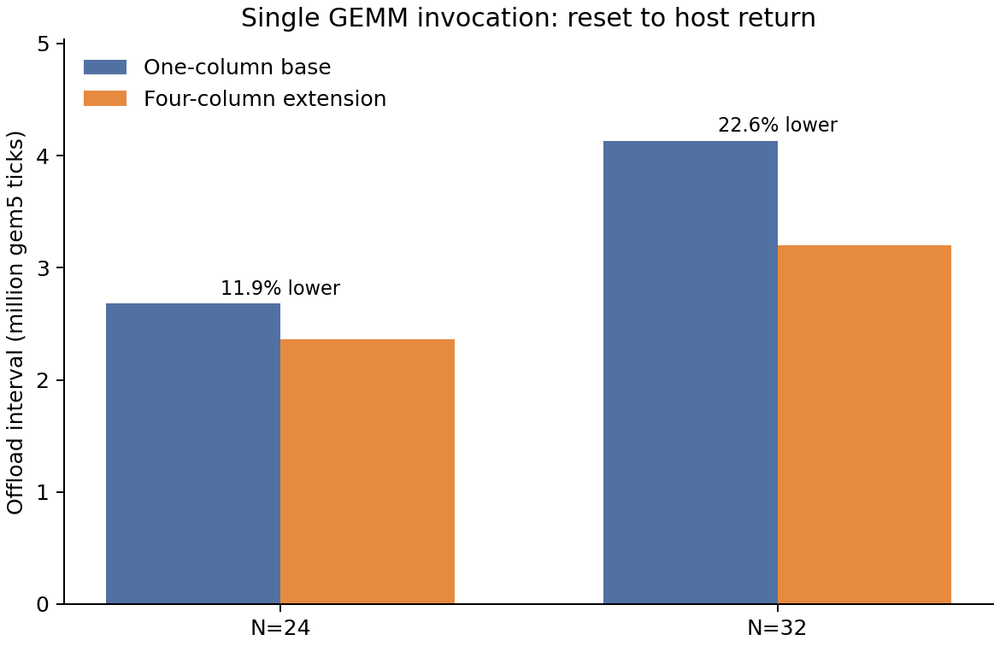

# Validated pilot results

The main comparison is the original one-column accelerator versus the
four-column accelerator on the **same** OoO CPU, cache/coherence system,
memory, clock, matrix input, and host invocation. Both use the same patched
gem5-Aladdin source. Each listed size passed separate full-output CPU and
accelerator checks with zero mismatches; the ROI checksums agreed. The
accelerator-host instruction counts matched between variants (21,600 at N=24;
30,046 at N=32).

| N | Base cycles | Four-column cycles | Cycle reduction | Base offload ticks | Four-column offload ticks | Offload reduction | Whole-program reduction |
| ---: | ---: | ---: | ---: | ---: | ---: | ---: | ---: |
| 24 | 1,452 | 1,133 | 21.97% | 2,680,000 | 2,361,000 | 11.90% | 0.47% |
| 32 | 2,827 | 1,984 | 29.82% | 4,132,000 | 3,200,000 | 22.56% | 1.18% |

The four-column accelerator versus an OoO CPU running the **same four-column
kernel** was 1.173x at N=24 and 1.524x at N=32 on whole-program ticks. This
is a secondary comparison. The original accelerator also outperformed its
own CPU version, so the baseline-to-extension columns above are the evidence
for the extension.

Full-check runs include a CPU reference GEMM after the accelerator and show
smaller whole-program differences: 136,062,000 versus 135,753,000 ticks at
N=24; 177,381,000 versus 176,575,000 at N=32. In the lightweight-check ROI,
the corresponding values are 60,962,000 versus 60,673,000 and 70,877,000
versus 70,042,000 ticks. Program startup and setup dilute the single-call
whole-program gain.

## How to audit the numbers

Run `python3 scripts/summarize.py`; it derives
[`validated_summary.csv`](../results/validated_summary.csv) from the raw logs
and stats in `results/`. For example, N=32 full correctness is in
`results/fair_results/{base_n32,tiled4_n32}/gem5-*.log`; whole-program
`sim_ticks` are in `results/roi_results/.../m5out-*/stats.txt`; two labeled
invocation segments are in `results/invocation_results/.../m5out-*/stats.txt`.
The saved `config.ini` files provide the effective gem5 configurations.

The ratio formulas are `(base - four_column) / base` for reductions and
`same_kernel_cpu_ticks / four_column_accel_ticks` for CPU-relative speedup.
Ticks are gem5 simulation ticks, not wall-clock execution time.

## Cost and validity limits

The N=32 Aladdin area report increased from 1.247 to 1.592 million µm²
(27.7%). N=24 area reports varied across otherwise matched reruns while timing
reproduced, so the present area data should be treated as exploratory. Power
has not been validated.

The repeated-input diagnostic changed A on the CPU between invocations. At
N=24 the accelerator variants each had 19 full-output mismatches, while the
CPU variants passed. Raw logs are in `results/diagnostics/repeated_input_n24/`.
This indicates a trace-reuse/modeling limitation and prevents a verified claim
that CPU-updated input reaches the accelerator correctly across repeated
calls. Only single-invocation, fixed-trace data is reported as valid timing.

The pilot has two N values and deterministic inputs. It establishes a
reproducible positive result in the model; it does not establish generality,
statistical confidence over workloads, dynamic coherence, or silicon behavior.
